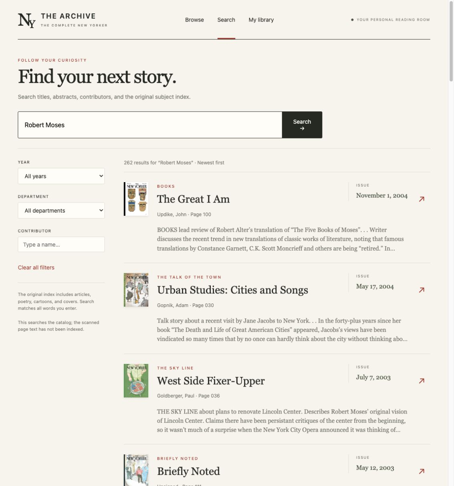
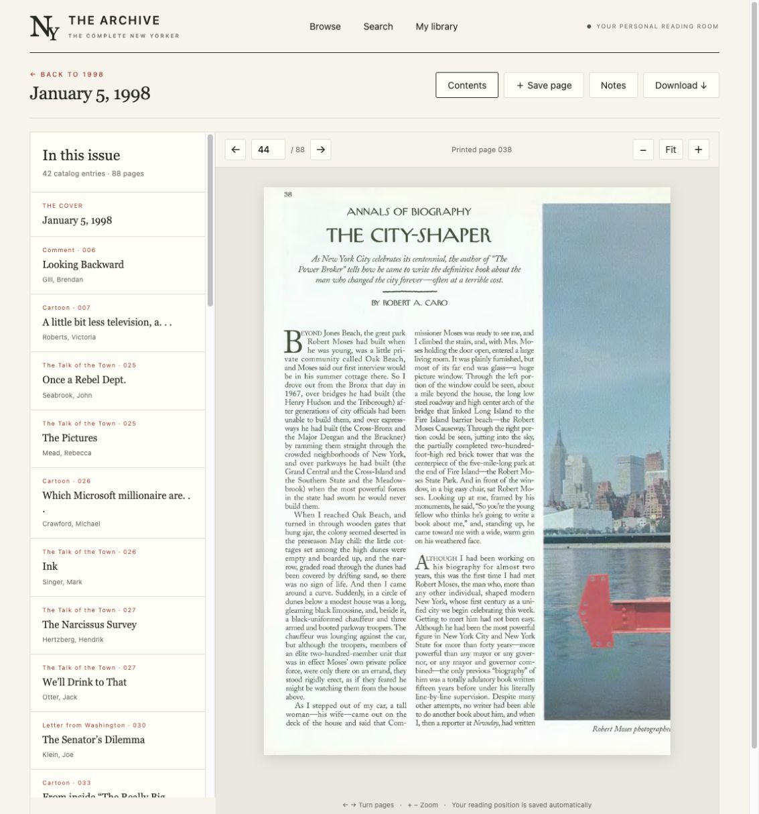
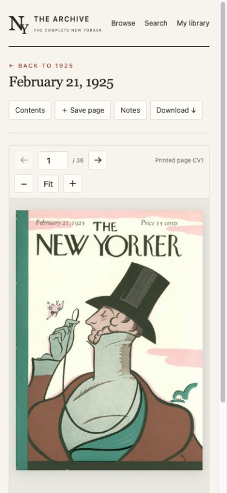

# The Archive

A standalone reading room for **The Complete New Yorker (1925–2005)**. Reads the original ISO-format `.mdf` disc images, decodes their SDJV pages, and serves a modern browser app. No original executable, activation service, external fonts, or cloud API is required.


**A modern home for an archive that outlived its original software.** Explore eight decades of issues, follow a contributor or topic, and read the original scans in your browser. Everything runs on your own machine or server, with local storage and no cloud service dependency.

This repository contains application code and interface screenshots. Bring your own original disc images; magazine files, the original catalog, and personal data are not included. This is an independent project, not affiliated with The New Yorker or Condé Nast.

## Features

- Cover browsing by decade/year and chronological sorting.
- Unified search over 188,792 catalog entries: titles, bylines, abstracts, and keywords, with contributor/department/year filters.
- Original scanned pages with zoom, keyboard navigation, printed page labels, issue contents, and automatic reading progress.
- Saved pages, named collections, and notes, stored in a separate personal database.
- Download a decoded, standard DjVu issue.
- On-demand document/image caching; original discs remain read-only.

## Screenshots

### Catalog search
Article titles and issue dates have distinct visual treatments, with filters for year, department, and contributor.



### Original-page reader
Jump from a catalog entry to its printed page, turn pages, zoom, and return to your saved reading position.



<details>
<summary>Mobile reader</summary>



</details>

## Quick start on macOS

Requires Python 3.12+ and DjVuLibre. First-time import also requires 7-Zip:

```sh
brew install djvulibre sevenzip
cp .env.example .env
# Edit .env: set TNY_SOURCE to your disc-image directory.
./start.sh
```

Open **http://localhost:8765**. The launcher reads `.env`; without configuration, it looks for images in `./discs`. If you are not using `.env`, configure it directly:

```sh
TNY_SOURCE=/path/to/discs TNY_DATA=/path/to/app-data ./start.sh
```

First startup imports the original catalog and thumbnails from the Mac installer on disc 1. It inventories the images without copying or mounting them. Allow a few minutes for import. The server starts once import finishes. Keep the archive drive connected while reading uncached issues.

## Run on a standalone server

Requires Docker with Compose:

```sh
cp .env.example .env
# Edit .env: set ARCHIVE_PATH to your disc-image directory.
docker compose up --build -d
```

Open http://localhost:8765. The source directory is mounted read-only; `./data` holds the normalized catalog, thumbnails, personal data, and caches. Move the application source and disc images to the server; the old application is unnecessary. Supported images have 2048-byte sectors and an ISO 9660 primary descriptor, as all eight supplied images do. The accompanying `.mds` files are not needed.

The app defaults to loopback access. It has **one shared personal library and no account system**. For remote access, use an SSH tunnel (`ssh -L 8765:localhost:8765 your-server`) or a reverse proxy with authentication/TLS. Do not expose it as an unauthenticated public service. Native LAN hosting is possible with `TNY_HOST=0.0.0.0 ./start.sh`; all users then share bookmarks and notes.

## Data and maintenance

- `data/catalog.db`: normalized catalog and FTS5 index.
- `data/personal.db`: bookmarks, notes, and progress. Back this up.
- `data/covers/`: original cover thumbnails.
- `data/documents/`: standard DjVu copies, generated per issue on demand.
- `data/pages/`: rendered page JPEGs, generated on demand.
- `data/import.json`: import totals.

`documents/` and `pages/` can be removed while the server is stopped to reclaim space; they are rebuilt from the discs. The on-demand cache grows as you read; no automatic eviction is implemented. If the archive location changes, update `TNY_SOURCE` or `ARCHIVE_PATH`; stored image filenames are relative.

Rebuild the catalog while the server is stopped:

```sh
.venv/bin/python -m archive.importer --source /path/to/discs
```

If you already extracted the installer, pass `--legacy-root /path/to/extracted`. Import preserves `personal.db`. An interrupted import never replaces the previous complete catalog. Restart the server after importing to refresh catalog statistics.

## Scope and format

Search covers the original catalog, not OCR of the full scanned page text. Some catalog dates may have no matching file, and some printed folios repeat: links choose the first matching scan; every scan is available in the reader. Missing issues are visibly marked instead of fabricating content.

The decoder processes CELX Blowfish CBC chunks into ordinary DjVu, using the format described in [this independent format investigation](https://gist.github.com/NoMoreNicksLeft/d3a4a59c7b4de0cdef1e26695606e51c). It uses Python/PyCryptodome, then DjVuLibre for bundling/rendering. It does not load the original native libraries. The ISO reader deliberately uses the valid ISO 9660 view because the images' redundant UDF metadata causes stricter UDF parsers to fail.

## Verification

```sh
.venv/bin/pip install -r requirements-dev.txt
.venv/bin/python -m unittest discover -s tests -v
```

Portable decoder checks run without magazine files. Catalog and eight-disc integration tests run when the imported catalog and source images are available; otherwise they are explicitly skipped. Tests use temporary personal storage. GitHub Actions runs the portable suite on Python 3.12 and 3.14.

See [verification notes](docs/VALIDATION.md) for actual checks and limits. The native app has been verified on macOS; the Docker configuration has not yet been built or run here.

## Project layout

```text
archive/               Disc reader, importer, decoder, renderer, and HTTP API
static/                Browser interface; no frontend build step
tests/                Portable and optional integration checks
docs/                 Design notes, validation, and screenshots
compose.yaml           Self-hosted Docker configuration
start.sh               Native setup and launch script
```

The decoder protocol reference is credited above. Screenshot content belongs to its respective rights holders.
